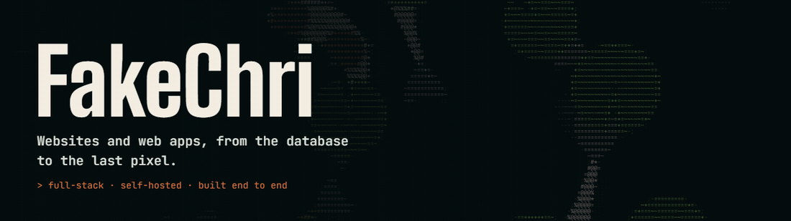

<p align="center">
  <a href="https://micheliagazzi.it"></a>
</p>

I build websites and web apps on my own, from the database schema to the server they run on. I'm studying Computer Science at the University of Milan, and I work as COO and developer at [ZenytCloud](https://zenytcloud.com), a VPS and game server hosting company.

My portfolio is at **[micheliagazzi.it](https://micheliagazzi.it)**.

### Right now

- **[My portfolio](https://micheliagazzi.it)**, rewritten from scratch in Laravel 13 and Filament. It runs on a server in my home behind a Cloudflare Tunnel, counts visits on its own server instead of sending them to a tracker, and opens on an ASCII koi pond that follows the real weather outside.
- **ZenytCloud's site and client area**, a custom theme for [Paymenter](https://github.com/Paymenter/Paymenter) (Laravel, Livewire, Tailwind CSS). Version 2 is the one online today.

### Things I've built

| Project | What it is | Stack |
|---|---|---|
| [ZenytCloud theme v1](https://micheliagazzi.it/progetti/zenytcloud-tema-v1) | Storefront, plan pages and client area for a hosting company | Laravel · Livewire · Tailwind |
| [AstralHosting](https://micheliagazzi.it/progetti/astralhosting) | The same idea for another hosting company, my first big project | Laravel · Paymenter |
| [Shoe shop](https://micheliagazzi.it/progetti/negozio-di-calzature) | Catalogue, product pages and a WhatsApp "ask if it's in stock" button | React · Vite · Tailwind |
| [Pizzeria](https://micheliagazzi.it/progetti/pizzeria-al-taglio) | Mobile-first menu on a chalkboard and a booking form drawn as a paper order slip | HTML · Tailwind · JavaScript |
| [Garage Elite](https://micheliagazzi.it/progetti/garage-elite) · [WWW](https://micheliagazzi.it/progetti/www) | School team projects: a car repair shop manager and a shipping tracker | PHP · MySQL |

Most of these live in private repositories. Each link opens the case study (in Italian), with screenshots and what I'd do differently.

### Tools I reach for

```text
languages   PHP · JavaScript · HTML · CSS · Bash
backend     Laravel · Filament · Livewire · Node.js
frontend    Tailwind CSS · React · Vite
data        MariaDB · MySQL
servers     Debian · Docker · Nginx · Proxmox · Cloudflare
```

<sub>The banner is a recording of the koi pond from my portfolio's home page.</sub>
